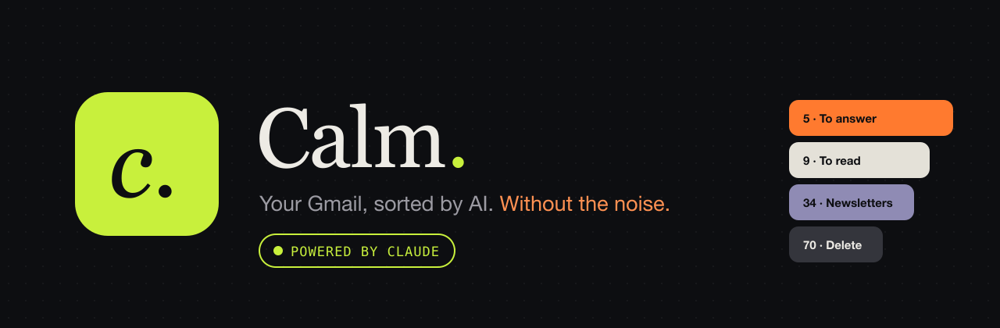
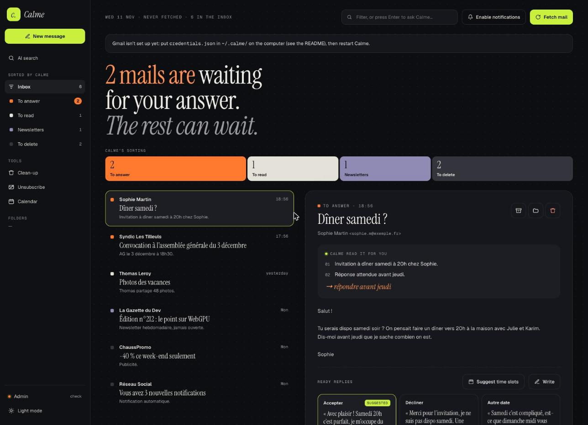

<p align="center">
  
</p>

<p align="center">
  <a href="https://claude.com/product/claude-code"></a>
  
  
  
</p>

# Calme

**Calme sorts your Gmail with Claude so you can stop living in your inbox.** It fetches your mail, sorts every message
(*to answer*, *to read*, *newsletters*, *to delete*), summarises it, drafts replies, spots appointments, suggests what
to delete and which newsletters to drop. You decide; Calme does it. **Nothing is sent, deleted or unsubscribed
without your click.**

It runs on your own computer and uses **your Claude Code subscription** (`claude -p`) — no API key, no cloud of ours.



## Features

- **Smart triage** — every mail sorted into 4 categories with a short summary and a suggested action.
- **Ready replies** — up to 3 drafts per mail in the right tone; rewrite with one sentence ("shorter", "more formal").
- **Write with Calme** — describe what you want to say, Calme writes the mail; To/Cc autocomplete from your contacts.
- **Calendar** — appointments found in mail, clash detection, one-click "add to calendar", free-slot suggestions, list/week/month views.
- **Clean-up** — promotions, notifications and stale mail grouped for one-click trashing (Gmail trash, recoverable 30 days).
- **Newsletter advisor** — Calme reads your reading habits and tells you which newsletters to unsubscribe from; optional automatic mode.
- **AI search** — ask a question in plain language; Calme searches a local full-text copy of your mail and Gmail, then answers.
- **Local mail base** — your received and sent mail mirrored on your computer (SQLite FTS5), synced at every fetch.
- **Everywhere** — desktop app for macOS, Windows and Linux (menu bar icon, notifications, starts at login) and an
  iPhone home-screen app with push notifications.
- **English and French** — switch in *Admin*; Calme's own texts (summaries, replies, notifications) follow.
- **Gmail quota-aware** — a live gauge and a throttle that keeps you under Google's per-minute limit.

## How it works

```
 iPhone (PWA) ──┐                         ┌── Gmail API / Google Calendar API
 Desktop app ───┼── Calme server ─────────┤
 Browser ───────┘   127.0.0.1:4747        └── claude -p  (your Claude Code subscription,
                    SQLite in ~/.calme                    no tools, JSON-schema answers)
```

- **Server** (`server/`) — Node 24 + TypeScript, Hono, `node:sqlite` (with FTS5), Gmail & Calendar APIs, Web Push.
- **UI** (`web/`) — Vue 3 + TypeScript + vue-i18n, built with Vite; also a PWA.
- **Desktop** (`desktop/`) — Electron; embeds the server and runs it permanently.

## Install

### 1. Requirements

- [Claude Code](https://claude.com/product/claude-code) installed and signed in (`claude` works in a terminal).
  On Windows, use the native installer (`claude.exe`).
- For development: Node.js 24+ and pnpm.

### 2. Desktop app (recommended)

Download the installer for your system from the [latest release](../../releases/latest):
`.dmg` (macOS, Apple silicon or Intel), `.exe` (Windows) or `.AppImage` (Linux). The builds are not code-signed:

- **macOS** — drag Calme to Applications, then right-click › *Open* the first time.
- **Windows** — *More info* › *Run anyway*.
- **Linux** — `chmod +x Calme-*.AppImage` and run it.

The app runs the Calme server in the background, starts at login (toggle in the menu bar icon menu), shows the number
of mails to answer in the menu bar and notifies you of every new mail. Logs: `~/.calme/server.log`.

### 3. Connect Gmail (once, ~10 minutes)

On first launch, a **setup assistant** checks Claude Code, guides you through the Google steps below, lets you drop
the downloaded client file into the app and authorises Gmail and Calendar. You can run it again from *Admin*.

Google requires every app to have its own OAuth client. It is free.

1. Open <https://console.cloud.google.com>, create a project.
2. *APIs & Services › Library*: enable **Gmail API** and **Google Calendar API**.
3. *Google Auth Platform › Branding*: app type **External**, name it, add your address as support and developer contact.
4. *Audience*: add your Gmail address as a **test user**. (In *Testing* mode Google signs you out every 7 days;
   publishing to *Production* requires a public home page and privacy policy URL.)
5. *Clients › Create client*: type **Desktop app**. Download the JSON.
6. Save it as `~/.calme/credentials.json` (Windows: `C:\Users\<you>\.calme\credentials.json`).
7. Restart Calme and, **on that computer**, open <http://127.0.0.1:4747/auth/google>.

Calme asks for three permissions: read and organise mail (`gmail.modify` — no permanent deletion possible), send mail
(`gmail.send`) and read/create calendar events (`calendar.events`). Tokens stay in `~/.calme/`, readable by you only.

### 4. iPhone

1. Install [Tailscale](https://tailscale.com) on the computer and the iPhone (same account); enable MagicDNS and HTTPS.
2. On the computer: `tailscale serve --bg 4747` — Calme is now reachable at
   `https://<computer>.<tailnet>.ts.net`, **only from your own devices**.
3. On the iPhone, open that address in Safari › *Share* › *Add to Home Screen*.
4. Open Calme from the icon, paste the pairing token (`pnpm calme pair`), then *Enable notifications*.

## Run from source

```bash
git clone https://github.com/DamienGdn/calme.git && cd calme
pnpm install
pnpm build            # builds the Vue UI
pnpm start            # server on http://127.0.0.1:4747
pnpm calme pair       # prints the pairing token
```

Desktop app from source: `pnpm -C desktop start`. Installers: `pnpm -C desktop dist`, or push a `v*` tag — GitHub
Actions builds macOS, Windows and Linux installers and attaches them to a release.

| Variable | Default | Purpose |
|---|---|---|
| `CALME_HOME` | `~/.calme` | data, tokens, database |
| `CALME_PORT` | `4747` | local port |
| `CALME_MODEL` | `sonnet` | default model (also in *Admin*) |
| `CALME_INTERVAL_MIN` | `5` | minutes between fetches (also in *Admin*) |
| `CALME_CLAUDE_BIN` | `claude` | path to Claude Code if not on `PATH` |

### With Claude Code

This repository is set up for Claude Code (`CLAUDE.md`). Two slash commands drive Calme from your terminal:
`/tri` (fetch, sort and summarise what needs an answer) and `/menage` (prepare the clean-up). CLI:
`pnpm calme status | list [reply|read|news|trash] | sync | triage | cycle | pair`.

## Security & privacy

- Mail never leaves your computer except to Google (Gmail/Calendar) and Anthropic (Claude, through your own Claude Code).
- During triage Claude has **no tools** (`claude -p --tools ""`, no MCP servers, no user settings) and can only answer
  schema-validated JSON — a booby-trapped email cannot make it act on your machine. Mail content is fenced as untrusted data.
- The server listens on `127.0.0.1` only; every `/api` call needs the pairing token. Remote access goes through your
  private Tailscale network. Gmail authorisation is only accepted from the computer itself.
- "Delete" means the Gmail trash (recoverable for 30 days). Unsubscribing uses the sender's official link.

## Development

```bash
pnpm test                 # server tests (Vitest)
pnpm -C web dev           # UI dev server (proxies /api to :4747)
pnpm -C server typecheck
```

---

## License

MIT with the [Commons Clause](LICENSE): free to use, fork and modify — **not for sale** (you may not sell Calme or a
product or service whose value derives substantially from it). Contributions are welcome through pull requests on
this repository — see [CONTRIBUTING.md](CONTRIBUTING.md).

---

<p align="center"><sub>Built with Claude Code · Powered by Claude</sub></p>
